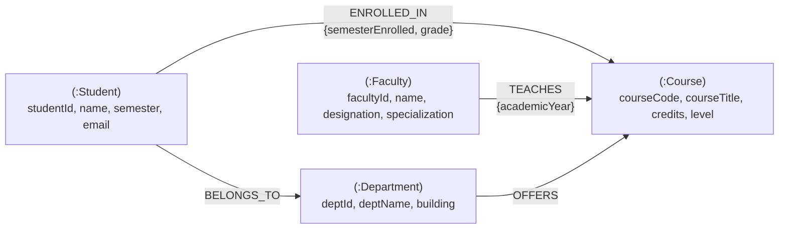

# Graph Analytics Assignment 5: University Course Registration System Using Neo4j

**Alliance School of Advanced Computing**  
**Faculty of Engineering and Technology, Alliance University**  
- **Course:** Graph Analytics (`E1ITC302`)  
- **Assignment No:** Assignment 5 — University Course Registration System Using Neo4j  
- **Student Name:** Kaaysha Rao  
- **Registration Number:** `2411021060775`  
- **GitHub Repository:** [Graph-Analytics / Assignmnet 5](https://github.com/KaayshaRao20/Graph-Analytics/tree/main/Assignmnet%205)

---

## 1. Project Overview

This repository implements an end-to-end Graph Database for a **University Course Registration System** using **Neo4j** and the **Cypher Query Language**. The system models students, faculty members, academic courses, and university departments as graph nodes, interconnecting them through typed, directed, and attributed relationships.

### Directory Structure

```plaintext
Assignmnet 5/
├── assignment5.cypher              # All Cypher queries in exact execution order
├── README.md                       # Comprehensive setup, execution, and query guide
├── report/
│   └── Assignment_5_Graph_Analytics_Neo4j_Submission.docx   # Completed Word report (university format)
└── results/
    ├── query_results.md            # Formatted query outputs and markdown walkthrough
    ├── outputs/                    # Individual text output files for all tasks
    │   ├── task_01_to_03.txt
    │   ├── task_04.txt
    │   ├── task_05.txt
    │   ├── ...
    │   └── task_14.txt
    └── screenshots/                # Verified high-resolution Neo4j Browser screenshots
        ├── task01_to_03_graph_creation_and_properties.png
        ├── task04_complete_graph_visualization.png
        ├── task05_node_counts_by_label.png
        ├── task06_relationship_types_and_directions.png
        ├── task07_students_in_semester_5.png
        ├── task08_courses_credits_greater_than_3.png
        ├── task09_courses_taught_by_dr_meera_sen.png
        ├── task10_students_enrolled_in_graph_analytics.png
        ├── task11_students_belonging_to_computer_science.png
        ├── task12_courses_offered_by_information_technology.png
        ├── task13_students_enrolled_in_nosql_databases.png
        ├── task14_students_in_graph_analytics_and_another_course.png
        └── image1.png ... image12.png (original raw captures)
```

---

## 2. Graph Data Model & Schema

The graph schema consists of **4 Node Labels** (14 nodes in total) and **4 Directed Relationship Types** (26 edges in total).

### Nodes and Properties

| Label | Count | Primary Key | Key Attributes |
|---|---|---|---|
| `:Student` | 5 | `studentId` (`S101` - `S105`) | `name`, `semester`, `email` |
| `:Faculty` | 2 | `facultyId` (`F101`, `F102`) | `name`, `designation`, `specialization` |
| `:Course` | 5 | `courseCode` (`CS301` - `CS305`) | `courseTitle`, `credits`, `level` |
| `:Department` | 2 | `deptId` (`D101`, `D102`) | `deptName`, `building` |

### Relationships and Properties

| Relationship | Direction | Edge Properties | Semantic Meaning |
|---|---|---|---|
| `[:ENROLLED_IN]` | `(:Student) -> (:Course)` | `semesterEnrolled` (3 or 5), `grade` (`'Not Published'`) | Student course registration |
| `[:TEACHES]` | `(:Faculty) -> (:Course)` | `academicYear` (`'2026-27'`) | Faculty course instructional assignment |
| `[:BELONGS_TO]` | `(:Student) -> (:Department)` | — | Student academic home department |
| `[:OFFERS]` | `(:Department) -> (:Course)` | — | Department offering the curriculum course |

### Mermaid Schema Diagram



---

## 3. Sample Data Specifications

### A. Students (5 Nodes)
- `S101`: Aarav Sharma | Semester 5 | `aarav@univ.edu`
- `S102`: Priya Das | Semester 5 | `priya@univ.edu`
- `S103`: Rahul Verma | Semester 3 | `rahul@univ.edu`
- `S104`: Sneha Roy | Semester 3 | `sneha@univ.edu`
- `S105`: Arjun Patel | Semester 5 | `arjun@univ.edu`

### B. Faculty (2 Nodes)
- `F101`: Dr. Meera Sen | Associate Professor | Specialization: Database Systems
- `F102`: Dr. Amit Roy | Assistant Professor | Specialization: Data Analytics

### C. Courses (5 Nodes)
- `CS301`: Graph Analytics | 3 Credits | Advanced
- `CS302`: Database Management Systems | 4 Credits | Core
- `CS303`: Data Mining | 3 Credits | Advanced
- `CS304`: Big Data Analytics | 4 Credits | Advanced
- `CS305`: NoSQL Databases | 3 Credits | Core

### D. Departments (2 Nodes)
- `D101`: Computer Science | Building: Block A
- `D102`: Information Technology | Building: Block B

### E. Associations and Enrolments
1. **Student Enrolments (`ENROLLED_IN`):**
   - Aarav Sharma (`S101`) -> Graph Analytics (`CS301`), DBMS (`CS302`), NoSQL Databases (`CS305`)
   - Priya Das (`S102`) -> Graph Analytics (`CS301`), Data Mining (`CS303`)
   - Rahul Verma (`S103`) -> DBMS (`CS302`), Big Data Analytics (`CS304`)
   - Sneha Roy (`S104`) -> Data Mining (`CS303`), NoSQL Databases (`CS305`)
   - Arjun Patel (`S105`) -> Graph Analytics (`CS301`), Big Data Analytics (`CS304`)
2. **Faculty Teaching Assignments (`TEACHES`):**
   - Dr. Meera Sen (`F101`) -> DBMS (`CS302`), NoSQL Databases (`CS305`)
   - Dr. Amit Roy (`F102`) -> Graph Analytics (`CS301`), Data Mining (`CS303`), Big Data Analytics (`CS304`)
3. **Student Department Associations (`BELONGS_TO`):**
   - Aarav Sharma, Priya Das, Rahul Verma -> Computer Science (`D101`)
   - Sneha Roy, Arjun Patel -> Information Technology (`D102`)
4. **Department Course Associations (`OFFERS`):**
   - Computer Science (`D101`) -> DBMS (`CS302`), Data Mining (`CS303`), NoSQL Databases (`CS305`)
   - Information Technology (`D102`) -> Graph Analytics (`CS301`), Big Data Analytics (`CS304`)

---

## 4. Setup and Execution Guide

### Prerequisites
- Neo4j Desktop (v5.x / v4.x) OR Neo4j AuraDB (Cloud Free Tier) OR Neo4j Docker container.
- Web Browser accessing Neo4j Browser interface at `http://localhost:7474`.

### Step-by-Step Execution in Neo4j Browser

1. **Launch Neo4j Database:**
   - In Neo4j Desktop, start your active local DBMS (or connect to your Aura instance).
   - Open Neo4j Browser at `http://localhost:7474` and log in with your credentials.

2. **Run Uniqueness Constraints (Optional, Recommended):**
   Execute in the query prompt:
   ```cypher
   CREATE CONSTRAINT student_id_unique IF NOT EXISTS FOR (s:Student) REQUIRE s.studentId IS UNIQUE;
   CREATE CONSTRAINT faculty_id_unique IF NOT EXISTS FOR (f:Faculty) REQUIRE f.facultyId IS UNIQUE;
   CREATE CONSTRAINT course_code_unique IF NOT EXISTS FOR (c:Course) REQUIRE c.courseCode IS UNIQUE;
   CREATE CONSTRAINT dept_id_unique IF NOT EXISTS FOR (d:Department) REQUIRE d.deptId IS UNIQUE;
   ```

3. **Execute `assignment5.cypher`:**
   - Open [`assignment5.cypher`](assignment5.cypher) in your IDE or text editor.
   - Run the node and relationship creation blocks sequentially.
   - Verify that the result status indicates: `Added 14 labels, created 14 nodes, set 42 properties, created 26 relationships`.

4. **Verify Queries (Tasks 4 to 14):**
   - Copy each task query into the Neo4j query editor and click the Play/Run button (`Ctrl + Enter`).
   - Compare results with the verified outputs and screenshots in [`results/query_results.md`](results/query_results.md).

---

## 5. Summary of Programming Tasks & Results

### Part A — Graph Creation and Verification

#### Task 1 to 3: Node Creation, Relationships, and Properties
- **Cypher Execution:** Created 14 nodes, 26 relationships, 42 properties.
- **Screenshot:** `results/screenshots/task01_to_03_graph_creation_and_properties.png`

#### Task 4: Display Complete Graph
```cypher
MATCH (n)-[r]->(m)
RETURN n, r, m;
```
- **Output:** Fully connected interactive property graph visualization containing 14 nodes and 26 directed edges.
- **Screenshot:** `results/screenshots/task04_complete_graph_visualization.png`

#### Task 5: Count of Nodes Belonging to Each Label
```cypher
MATCH (n)
RETURN labels(n)[0] AS Label, count(n) AS NodeCount
ORDER BY NodeCount DESC;
```
| Label | NodeCount |
|---|---|
| Student | 5 |
| Course | 5 |
| Faculty | 2 |
| Department | 2 |
- **Screenshot:** `results/screenshots/task05_node_counts_by_label.png`

#### Task 6: Display All Relationship Types and Verify Directions
```cypher
MATCH (a)-[r]->(b)
RETURN DISTINCT type(r) AS RelationshipType,
       labels(a)[0] AS FromNode,
       labels(b)[0] AS ToNode,
       count(r) AS Count
ORDER BY RelationshipType;
```
| RelationshipType | FromNode | ToNode | Count |
|---|---|---|---|
| BELONGS_TO | Student | Department | 5 |
| ENROLLED_IN | Student | Course | 11 |
| OFFERS | Department | Course | 5 |
| TEACHES | Faculty | Course | 5 |
- **Screenshot:** `results/screenshots/task06_relationship_types_and_directions.png`

---

### Part B — Retrieval and Filtering Queries

#### Task 7: Retrieve All Students Studying in Semester 5
```cypher
MATCH (s:Student)
WHERE s.semester = 5
RETURN s.studentId AS StudentID, s.name AS Name, s.semester AS Semester, s.email AS Email
ORDER BY s.studentId;
```
| StudentID | Name | Semester | Email |
|---|---|---|---|
| S101 | Aarav Sharma | 5 | aarav@univ.edu |
| S102 | Priya Das | 5 | priya@univ.edu |
| S105 | Arjun Patel | 5 | arjun@univ.edu |
- **Screenshot:** `results/screenshots/task07_students_in_semester_5.png`

#### Task 8: Find All Courses with More Than 3 Credits
```cypher
MATCH (c:Course)
WHERE c.credits > 3
RETURN c.courseCode AS CourseCode, c.courseTitle AS CourseTitle, c.credits AS Credits, c.level AS Level;
```
| CourseCode | CourseTitle | Credits | Level |
|---|---|---|---|
| CS302 | Database Management Systems | 4 | Core |
| CS304 | Big Data Analytics | 4 | Advanced |
- **Screenshot:** `results/screenshots/task08_courses_credits_greater_than_3.png`

#### Task 9: Retrieve the Courses Taught by Dr. Meera Sen
```cypher
MATCH (f:Faculty {name: 'Dr. Meera Sen'})-[:TEACHES]->(c:Course)
RETURN f.name AS FacultyName, c.courseCode AS CourseCode, c.courseTitle AS CourseTitle, c.credits AS Credits;
```
| FacultyName | CourseCode | CourseTitle | Credits |
|---|---|---|---|
| Dr. Meera Sen | CS302 | Database Management Systems | 4 |
| Dr. Meera Sen | CS305 | NoSQL Databases | 3 |
- **Screenshot:** `results/screenshots/task09_courses_taught_by_dr_meera_sen.png`

#### Task 10: Find All Students Enrolled in Graph Analytics
```cypher
MATCH (s:Student)-[:ENROLLED_IN]->(c:Course {courseTitle: 'Graph Analytics'})
RETURN s.studentId AS StudentID, s.name AS Name, s.semester AS Semester, c.courseTitle AS EnrolledCourse;
```
| StudentID | Name | Semester | EnrolledCourse |
|---|---|---|---|
| S101 | Aarav Sharma | 5 | Graph Analytics |
| S102 | Priya Das | 5 | Graph Analytics |
| S105 | Arjun Patel | 5 | Graph Analytics |
- **Screenshot:** `results/screenshots/task10_students_enrolled_in_graph_analytics.png`

#### Task 11: Display Names of All Students Belonging to Computer Science Department
```cypher
MATCH (s:Student)-[:BELONGS_TO]->(d:Department {deptName: 'Computer Science'})
RETURN s.studentId AS StudentID, s.name AS StudentName, d.deptName AS Department;
```
| StudentID | StudentName | Department |
|---|---|---|
| S101 | Aarav Sharma | Computer Science |
| S102 | Priya Das | Computer Science |
| S103 | Rahul Verma | Computer Science |
- **Screenshot:** `results/screenshots/task11_students_belonging_to_computer_science.png`

#### Task 12: Find All Courses Offered by Information Technology Department
```cypher
MATCH (d:Department {deptName: 'Information Technology'})-[:OFFERS]->(c:Course)
RETURN d.deptName AS Department, c.courseCode AS CourseCode, c.courseTitle AS CourseTitle, c.credits AS Credits, c.level AS Level;
```
| Department | CourseCode | CourseTitle | Credits | Level |
|---|---|---|---|---|
| Information Technology | CS301 | Graph Analytics | 3 | Advanced |
| Information Technology | CS304 | Big Data Analytics | 4 | Advanced |
- **Screenshot:** `results/screenshots/task12_courses_offered_by_information_technology.png`

#### Task 13: Retrieve All Students Enrolled in NoSQL Databases Along with Semester and Grade
```cypher
MATCH (s:Student)-[r:ENROLLED_IN]->(c:Course {courseTitle: 'NoSQL Databases'})
RETURN s.studentId AS StudentID, s.name AS Name, r.semesterEnrolled AS SemesterEnrolled, r.grade AS Grade, c.courseTitle AS Course;
```
| StudentID | Name | SemesterEnrolled | Grade | Course |
|---|---|---|---|---|
| S101 | Aarav Sharma | 5 | Not Published | NoSQL Databases |
| S104 | Sneha Roy | 3 | Not Published | NoSQL Databases |
- **Screenshot:** `results/screenshots/task13_students_enrolled_in_nosql_databases.png`

#### Task 14: Find All Students Enrolled in Both Graph Analytics and Another Course
```cypher
MATCH (s:Student)-[:ENROLLED_IN]->(c1:Course {courseTitle: 'Graph Analytics'}),
      (s)-[:ENROLLED_IN]->(c2:Course)
WHERE c1 <> c2
RETURN s.studentId AS StudentID, s.name AS StudentName, c2.courseCode AS OtherCourseCode, c2.courseTitle AS OtherCourseTitle
ORDER BY s.studentId, c2.courseCode;
```
| StudentID | StudentName | OtherCourseCode | OtherCourseTitle |
|---|---|---|---|
| S101 | Aarav Sharma | CS302 | Database Management Systems |
| S101 | Aarav Sharma | CS305 | NoSQL Databases |
| S102 | Priya Das | CS303 | Data Mining |
| S105 | Arjun Patel | CS304 | Big Data Analytics |
- **Screenshot:** `results/screenshots/task14_students_in_graph_analytics_and_another_course.png`

---

## 6. Key Graph Analytics Insights

1. **Property Graph Expressiveness:** Modeling the academic ecosystem as a Labeled Property Graph (LPG) naturally expresses multi-entity associations without foreign keys, composite join tables, or NULL value columns.
2. **Index-Free Adjacency:** In Neo4j, path traversals (e.g. multi-hop hops from `Faculty` -> `Course` -> `Student` -> `Department`) operate in $O(k)$ time relative to vertex degree rather than costly Cartesian joins or $O(\log N)$ indexed lookups in Relational DBMS.
3. **First-Class Edge Attributes:** Properties stored directly on graph relationships (such as `semesterEnrolled` and `grade` on `[:ENROLLED_IN]`, and `academicYear` on `[:TEACHES]`) remove the requirement for intermediary junction tables.
4. **Pattern-Matching Power:** Cypher’s ASCII-art syntax allows complex path patterns like task 14 (`(s)-[:ENROLLED_IN]->(c1)` and `(s)-[:ENROLLED_IN]->(c2)`) to be formulated declaratively, concisely, and with high clarity.
