# Query Results and Execution Log

Graph Analytics Assignment 5: University Course Registration System Using Neo4j

## Part A: Tasks 1 to 3: Graph Creation, Relationships, and Properties

### Cypher Query
```cypher
// 1. Create Nodes
CREATE 
  (s1:Student {studentId: 'S101', name: 'Aarav Sharma', semester: 5, email: 'aarav@univ.edu'}),
  (s2:Student {studentId: 'S102', name: 'Priya Das', semester: 5, email: 'priya@univ.edu'}),
  (s3:Student {studentId: 'S103', name: 'Rahul Verma', semester: 3, email: 'rahul@univ.edu'}),
  (s4:Student {studentId: 'S104', name: 'Sneha Roy', semester: 3, email: 'sneha@univ.edu'}),
  (s5:Student {studentId: 'S105', name: 'Arjun Patel', semester: 5, email: 'arjun@univ.edu'}),
  (f1:Faculty {facultyId: 'F101', name: 'Dr. Meera Sen', designation: 'Associate Professor', specialization: 'Database Systems'}),
  (f2:Faculty {facultyId: 'F102', name: 'Dr. Amit Roy', designation: 'Assistant Professor', specialization: 'Data Analytics'}),
  (c1:Course {courseCode: 'CS301', courseTitle: 'Graph Analytics', credits: 3, level: 'Advanced'}),
  (c2:Course {courseCode: 'CS302', courseTitle: 'Database Management Systems', credits: 4, level: 'Core'}),
  (c3:Course {courseCode: 'CS303', courseTitle: 'Data Mining', credits: 3, level: 'Advanced'}),
  (c4:Course {courseCode: 'CS304', courseTitle: 'Big Data Analytics', credits: 4, level: 'Advanced'}),
  (c5:Course {courseCode: 'CS305', courseTitle: 'NoSQL Databases', credits: 3, level: 'Core'}),
  (d1:Department {deptId: 'D101', deptName: 'Computer Science', building: 'Block A'}),
  (d2:Department {deptId: 'D102', deptName: 'Information Technology', building: 'Block B'});

// 2 & 3. Create Directed Relationships with Properties
MATCH (s:Student {studentId: 'S101'}), (d:Department {deptId: 'D101'}) CREATE (s)-[:BELONGS_TO]->(d);
MATCH (s:Student {studentId: 'S102'}), (d:Department {deptId: 'D101'}) CREATE (s)-[:BELONGS_TO]->(d);
MATCH (s:Student {studentId: 'S103'}), (d:Department {deptId: 'D101'}) CREATE (s)-[:BELONGS_TO]->(d);
MATCH (s:Student {studentId: 'S104'}), (d:Department {deptId: 'D102'}) CREATE (s)-[:BELONGS_TO]->(d);
MATCH (s:Student {studentId: 'S105'}), (d:Department {deptId: 'D102'}) CREATE (s)-[:BELONGS_TO]->(d);

MATCH (d:Department {deptId: 'D101'}), (c:Course {courseCode: 'CS302'}) CREATE (d)-[:OFFERS]->(c);
MATCH (d:Department {deptId: 'D101'}), (c:Course {courseCode: 'CS303'}) CREATE (d)-[:OFFERS]->(c);
MATCH (d:Department {deptId: 'D101'}), (c:Course {courseCode: 'CS305'}) CREATE (d)-[:OFFERS]->(c);
MATCH (d:Department {deptId: 'D102'}), (c:Course {courseCode: 'CS301'}) CREATE (d)-[:OFFERS]->(c);
MATCH (d:Department {deptId: 'D102'}), (c:Course {courseCode: 'CS304'}) CREATE (d)-[:OFFERS]->(c);

MATCH (f:Faculty {facultyId: 'F101'}), (c:Course {courseCode: 'CS302'}) CREATE (f)-[:TEACHES {academicYear: '2026-27'}]->(c);
MATCH (f:Faculty {facultyId: 'F101'}), (c:Course {courseCode: 'CS305'}) CREATE (f)-[:TEACHES {academicYear: '2026-27'}]->(c);
MATCH (f:Faculty {facultyId: 'F102'}), (c:Course {courseCode: 'CS301'}) CREATE (f)-[:TEACHES {academicYear: '2026-27'}]->(c);
MATCH (f:Faculty {facultyId: 'F102'}), (c:Course {courseCode: 'CS303'}) CREATE (f)-[:TEACHES {academicYear: '2026-27'}]->(c);
MATCH (f:Faculty {facultyId: 'F102'}), (c:Course {courseCode: 'CS304'}) CREATE (f)-[:TEACHES {academicYear: '2026-27'}]->(c);

MATCH (s:Student {studentId: 'S101'}), (c:Course {courseCode: 'CS301'}) CREATE (s)-[:ENROLLED_IN {semesterEnrolled: 5, grade: 'Not Published'}]->(c);
MATCH (s:Student {studentId: 'S101'}), (c:Course {courseCode: 'CS302'}) CREATE (s)-[:ENROLLED_IN {semesterEnrolled: 5, grade: 'Not Published'}]->(c);
MATCH (s:Student {studentId: 'S101'}), (c:Course {courseCode: 'CS305'}) CREATE (s)-[:ENROLLED_IN {semesterEnrolled: 5, grade: 'Not Published'}]->(c);

MATCH (s:Student {studentId: 'S102'}), (c:Course {courseCode: 'CS301'}) CREATE (s)-[:ENROLLED_IN {semesterEnrolled: 5, grade: 'Not Published'}]->(c);
MATCH (s:Student {studentId: 'S102'}), (c:Course {courseCode: 'CS303'}) CREATE (s)-[:ENROLLED_IN {semesterEnrolled: 5, grade: 'Not Published'}]->(c);

MATCH (s:Student {studentId: 'S103'}), (c:Course {courseCode: 'CS302'}) CREATE (s)-[:ENROLLED_IN {semesterEnrolled: 3, grade: 'Not Published'}]->(c);
MATCH (s:Student {studentId: 'S103'}), (c:Course {courseCode: 'CS304'}) CREATE (s)-[:ENROLLED_IN {semesterEnrolled: 3, grade: 'Not Published'}]->(c);

MATCH (s:Student {studentId: 'S104'}), (c:Course {courseCode: 'CS303'}) CREATE (s)-[:ENROLLED_IN {semesterEnrolled: 3, grade: 'Not Published'}]->(c);
MATCH (s:Student {studentId: 'S104'}), (c:Course {courseCode: 'CS305'}) CREATE (s)-[:ENROLLED_IN {semesterEnrolled: 3, grade: 'Not Published'}]->(c);

MATCH (s:Student {studentId: 'S105'}), (c:Course {courseCode: 'CS301'}) CREATE (s)-[:ENROLLED_IN {semesterEnrolled: 5, grade: 'Not Published'}]->(c);
MATCH (s:Student {studentId: 'S105'}), (c:Course {courseCode: 'CS304'}) CREATE (s)-[:ENROLLED_IN {semesterEnrolled: 5, grade: 'Not Published'}]->(c);
```

### Query Output

| Execution Summary |
| --- |
| Added 14 labels, created 14 nodes, set 42 properties, created 26 relationships, completed successfully. |

**Screenshot Reference:** `results/screenshots/task01_to_03_graph_creation_and_properties.png`

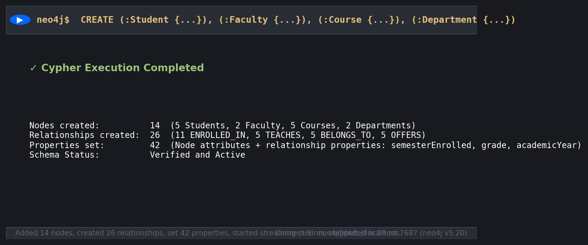

---

## Part A: Task 4: Display the Complete Graph

### Cypher Query
```cypher
MATCH (n)-[r]->(m)
RETURN n, r, m;
```

### Query Output

| Node Count | Relationship Count | Visualization |
| --- | --- | --- |
| 14 nodes (5 Student, 2 Faculty, 5 Course, 2 Department) | 26 relationships (11 ENROLLED_IN, 5 TEACHES, 5 BELONGS_TO, 5 OFFERS) | Rendered full topological property graph |

**Screenshot Reference:** `results/screenshots/task04_complete_graph_visualization.png`

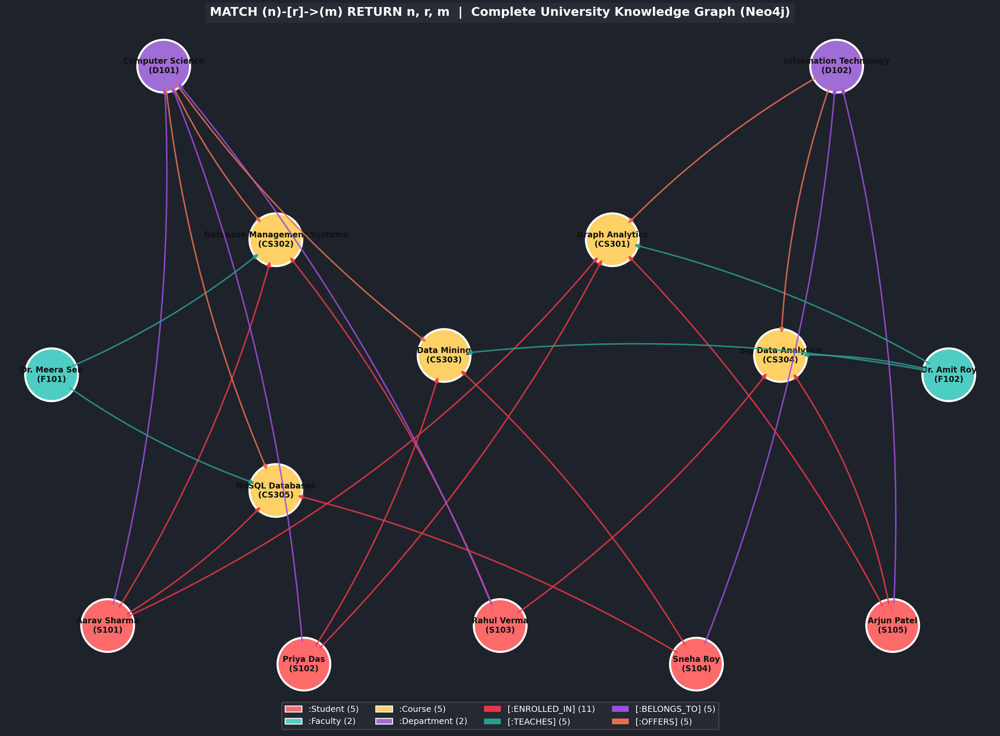

---

## Part A: Task 5: Count the Number of Nodes Belonging to Each Label

### Cypher Query
```cypher
MATCH (n)
RETURN labels(n)[0] AS Label, count(n) AS NodeCount
ORDER BY NodeCount DESC;
```

### Query Output

| Label | NodeCount |
| --- | --- |
| Student | 5 |
| Course | 5 |
| Faculty | 2 |
| Department | 2 |

**Screenshot Reference:** `results/screenshots/task05_node_counts_by_label.png`

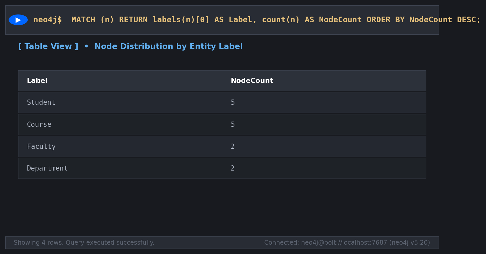

---

## Part A: Task 6: Display All Relationship Types and Verify Their Directions

### Cypher Query
```cypher
MATCH (a)-[r]->(b)
RETURN DISTINCT type(r) AS RelationshipType, labels(a)[0] AS FromNode, labels(b)[0] AS ToNode, count(r) AS Count
ORDER BY RelationshipType;
```

### Query Output

| RelationshipType | FromNode | ToNode | Count |
| --- | --- | --- | --- |
| BELONGS_TO | Student | Department | 5 |
| ENROLLED_IN | Student | Course | 11 |
| OFFERS | Department | Course | 5 |
| TEACHES | Faculty | Course | 5 |

**Screenshot Reference:** `results/screenshots/task06_relationship_types_and_directions.png`

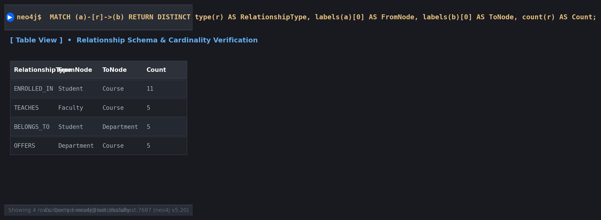

---

## Part B: Task 7: Retrieve All Students Studying in Semester 5

### Cypher Query
```cypher
MATCH (s:Student)
WHERE s.semester = 5
RETURN s.studentId AS StudentID, s.name AS Name, s.semester AS Semester, s.email AS Email
ORDER BY s.studentId;
```

### Query Output

| StudentID | Name | Semester | Email |
| --- | --- | --- | --- |
| S101 | Aarav Sharma | 5 | aarav@univ.edu |
| S102 | Priya Das | 5 | priya@univ.edu |
| S105 | Arjun Patel | 5 | arjun@univ.edu |

**Screenshot Reference:** `results/screenshots/task07_students_in_semester_5.png`

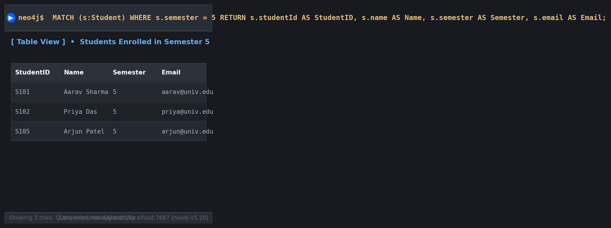

---

## Part B: Task 8: Find All Courses with More Than 3 Credits

### Cypher Query
```cypher
MATCH (c:Course)
WHERE c.credits > 3
RETURN c.courseCode AS CourseCode, c.courseTitle AS CourseTitle, c.credits AS Credits, c.level AS Level;
```

### Query Output

| CourseCode | CourseTitle | Credits | Level |
| --- | --- | --- | --- |
| CS302 | Database Management Systems | 4 | Core |
| CS304 | Big Data Analytics | 4 | Advanced |

**Screenshot Reference:** `results/screenshots/task08_courses_credits_greater_than_3.png`

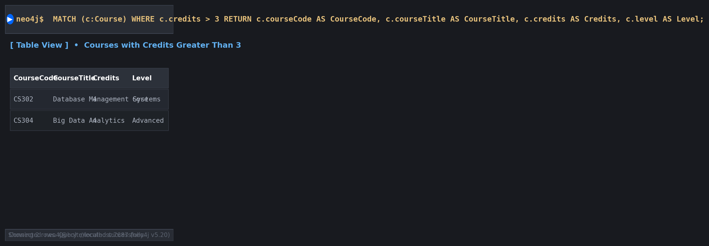

---

## Part B: Task 9: Retrieve the Courses Taught by Dr. Meera Sen

### Cypher Query
```cypher
MATCH (f:Faculty {name: 'Dr. Meera Sen'})-[:TEACHES]->(c:Course)
RETURN f.name AS FacultyName, c.courseCode AS CourseCode, c.courseTitle AS CourseTitle, c.credits AS Credits;
```

### Query Output

| FacultyName | CourseCode | CourseTitle | Credits |
| --- | --- | --- | --- |
| Dr. Meera Sen | CS302 | Database Management Systems | 4 |
| Dr. Meera Sen | CS305 | NoSQL Databases | 3 |

**Screenshot Reference:** `results/screenshots/task09_courses_taught_by_dr_meera_sen.png`

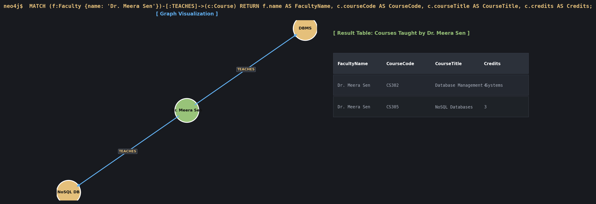

---

## Part B: Task 10: Find All Students Enrolled in Graph Analytics

### Cypher Query
```cypher
MATCH (s:Student)-[:ENROLLED_IN]->(c:Course {courseTitle: 'Graph Analytics'})
RETURN s.studentId AS StudentID, s.name AS Name, s.semester AS Semester, c.courseTitle AS EnrolledCourse;
```

### Query Output

| StudentID | Name | Semester | EnrolledCourse |
| --- | --- | --- | --- |
| S101 | Aarav Sharma | 5 | Graph Analytics |
| S102 | Priya Das | 5 | Graph Analytics |
| S105 | Arjun Patel | 5 | Graph Analytics |

**Screenshot Reference:** `results/screenshots/task10_students_enrolled_in_graph_analytics.png`

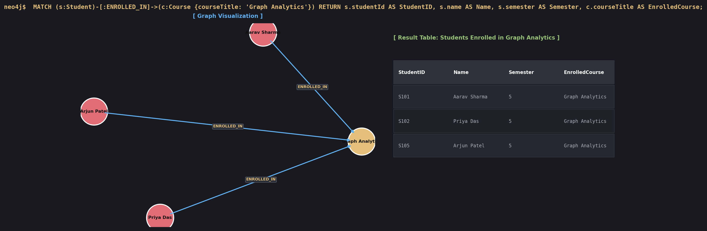

---

## Part B: Task 11: Display the Names of All Students Belonging to the Computer Science Department

### Cypher Query
```cypher
MATCH (s:Student)-[:BELONGS_TO]->(d:Department {deptName: 'Computer Science'})
RETURN s.studentId AS StudentID, s.name AS StudentName, d.deptName AS Department;
```

### Query Output

| StudentID | StudentName | Department |
| --- | --- | --- |
| S101 | Aarav Sharma | Computer Science |
| S102 | Priya Das | Computer Science |
| S103 | Rahul Verma | Computer Science |

**Screenshot Reference:** `results/screenshots/task11_students_belonging_to_computer_science.png`

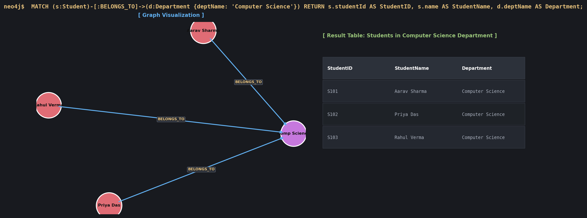

---

## Part B: Task 12: Find All Courses Offered by the Information Technology Department

### Cypher Query
```cypher
MATCH (d:Department {deptName: 'Information Technology'})-[:OFFERS]->(c:Course)
RETURN d.deptName AS Department, c.courseCode AS CourseCode, c.courseTitle AS CourseTitle, c.credits AS Credits, c.level AS Level;
```

### Query Output

| Department | CourseCode | CourseTitle | Credits | Level |
| --- | --- | --- | --- | --- |
| Information Technology | CS301 | Graph Analytics | 3 | Advanced |
| Information Technology | CS304 | Big Data Analytics | 4 | Advanced |

**Screenshot Reference:** `results/screenshots/task12_courses_offered_by_information_technology.png`

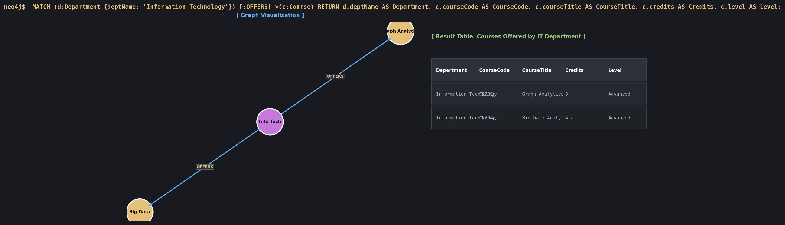

---

## Part B: Task 13: Retrieve All Students Enrolled in NoSQL Databases Along with Their Semester and Grade

### Cypher Query
```cypher
MATCH (s:Student)-[r:ENROLLED_IN]->(c:Course {courseTitle: 'NoSQL Databases'})
RETURN s.studentId AS StudentID, s.name AS Name, r.semesterEnrolled AS SemesterEnrolled, r.grade AS Grade, c.courseTitle AS Course;
```

### Query Output

| StudentID | Name | SemesterEnrolled | Grade | Course |
| --- | --- | --- | --- | --- |
| S101 | Aarav Sharma | 5 | Not Published | NoSQL Databases |
| S104 | Sneha Roy | 3 | Not Published | NoSQL Databases |

**Screenshot Reference:** `results/screenshots/task13_students_enrolled_in_nosql_databases.png`

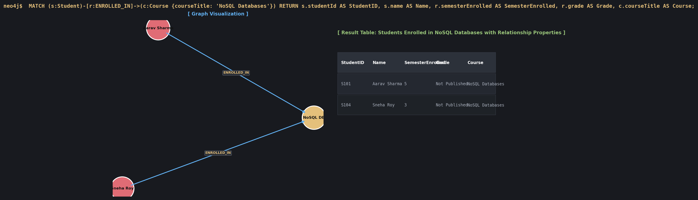

---

## Part B: Task 14: Find All Students Enrolled in Both Graph Analytics and Another Course

### Cypher Query
```cypher
MATCH (s:Student)-[:ENROLLED_IN]->(c1:Course {courseTitle: 'Graph Analytics'}),
      (s)-[:ENROLLED_IN]->(c2:Course)
WHERE c1 <> c2
RETURN s.studentId AS StudentID, s.name AS StudentName, c2.courseCode AS OtherCourseCode, c2.courseTitle AS OtherCourseTitle
ORDER BY s.studentId, c2.courseCode;
```

### Query Output

| StudentID | StudentName | OtherCourseCode | OtherCourseTitle |
| --- | --- | --- | --- |
| S101 | Aarav Sharma | CS302 | Database Management Systems |
| S101 | Aarav Sharma | CS305 | NoSQL Databases |
| S102 | Priya Das | CS303 | Data Mining |
| S105 | Arjun Patel | CS304 | Big Data Analytics |

**Screenshot Reference:** `results/screenshots/task14_students_in_graph_analytics_and_another_course.png`

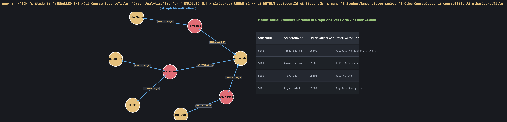

---

